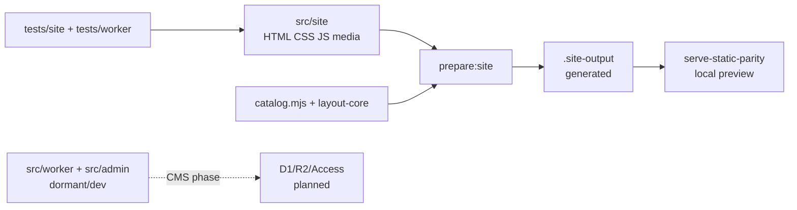

# Kiến trúc runtime Trường Thịnh

Website hiện đi theo static-first. `src/site/` là source public canonical;
`scripts/site/prepare-static-assets.mjs` tạo `.site-output/`; Node static server
phục vụ local preview. Worker, D1, R2 và admin là scaffold dormant/dev cho CMS
phase, không phải dependency của public static release.

## Các lớp runtime



| Lớp | Trạng thái | Nguồn và ranh giới |
| --- | --- | --- |
| Public static | Đang dùng | `src/site/`, local assets và shared CSS/JS; không cần D1, R2, Access hoặc CMS secret |
| Static build | Đang dùng | `scripts/site/prepare-static-assets.mjs` copy source/vendor, tạo catalog artifact, sáu compatibility HTML và 22 HTML VI/EN vào `.site-output/` |
| Local preview | Đang dùng | `pnpm dev` chạy `prepare:site` rồi `scripts/tooling/serve-static-parity.mjs --port 8787` |
| QA | Chỉ ở repository | `tests/` và scripts kiểm chứng source/build; không thuộc public output |
| Demo hosting | Đã chọn cho static release | `pnpm deploy:demo` đẩy `.site-output/` lên Workers static assets qua `wrangler.static.toml`; không Worker script, không binding |
| Worker | Dormant | `src/worker/index.js` giữ route, SEO, API và CMS boundary; Wrangler chưa thuộc static gate |
| Admin | Dev/dormant | `src/admin/` là shell private cho CMS, không copy vào public output |
| CMS data | Planned | D1/R2/Access/provider chỉ chọn và verify khi owner mở CMS phase |

## Route canonical

Các route dưới đây là public static contract. `locale` là `vi` hoặc `en`.

| Route | Source hiện tại | Ghi chú |
| --- | --- | --- |
| `/{locale}/` | `src/site/index.html` | Homepage |
| `/{locale}/residential/` | `src/site/residential/index.html` | Detail nhà ở |
| `/{locale}/commercial/` | `src/site/commercial/index.html` | Detail kinh doanh, horizontal gallery |
| `/{locale}/advertising-products/` | `src/site/advertising-products/index.html` | Catalog, filter, masonry |
| `/{locale}/advertising-products/{slug}/` | `scripts/site/prepare-static-assets.mjs` + `catalog.mjs` | Sáu compatibility entry chuyển về parent `?category=<slug>`; photo view hiện hành dùng query `photo` |
| `/{locale}/about/` | `src/site/about/index.html` | About/detail |

`/{locale}/projects/:slug/` là CMS target trong tương lai, không phải current
static detail route. `src/worker/index.js` vẫn giữ parser và lookup cho target
này để bảo toàn contract tương lai. Legacy/source aliases thuộc redirect
compatibility trong Worker dormant; không dùng chúng làm canonical source path.

## Luồng public hiện tại

1. `src/site/` giữ markup, content, CSS, runtime và media local.
2. `pnpm prepare:site` chạy generator; script tạo catalog artifact, resolve
   `renderDetailComposition(category, products)` và ghi sáu detail route.
3. `src/site/motion.js` giữ locale, route veil, header/menu, scroll và motion;
   `src/site/detail.js` mount detail behavior và điều phối catalog lifecycle.
4. `src/site/advertising-products/catalog-runtime.mjs` validate artifact,
   compile geometry, mount filter/masonry, virtualization, media replay và cleanup.
5. `scripts/tooling/serve-static-parity.mjs` phục vụ `.site-output/`; output
   generated không được edit.

Chi tiết từng phần website nằm trong spec theo
[capability map](specs/docs-system.md#r2-capability-map-và-spec-sống). Worker,
admin, D1 và điều kiện mở CMS nằm trong [spec CMS](specs/cms.md); spec dẫn tới
nguồn sở hữu contract thay vì chép lại toàn bộ requirement.

## Trust boundary và fallback

| Boundary | Dữ liệu/capability | Khi lỗi |
| --- | --- | --- |
| Source → build | Catalog, layout, template, local media | Generator throw khi thiếu hero/media hoặc block kind/source không hợp lệ; output lỗi không được coi là release |
| Artifact → catalog runtime | `catalog-artifact.mjs`, version, category/card invariant | `catalog-runtime.mjs` fail-closed khi artifact/version/dependency không hợp lệ; no-script card shell vẫn là fallback markup |
| Runtime dependency | Masonry, Lazysizes, GSAP, Swiper | Nội dung đọc được; catalog enhancement hoặc motion không được phép làm mất content; Advertising detail carousel giữ native state khi Swiper lỗi |
| Public static → CMS | Static HTML và dữ liệu published tương lai | Static output giữ vai trò fallback/rollback; CMS incident không được làm mất static route |
| Admin write | Access JWT, asserted email, allowlist, origin và input validation | Từ chối request; không lộ admin state ra public |

Static runtime không đọc D1/R2. Không ghi production runtime PASS, deploy PASS
hoặc CMS provider decision từ tài liệu này; các claim đó cần evidence riêng.

## Deployment và kiểm chứng

Demo hosting theo [quyết định demo Cloudflare](decisions/cloudflare-workers-static-demo.md);
Wrangler cho CMS khóa tới CMS theo [decision deferred Wrangler](decisions/wrangler-deferred-until-cms.md).

Các command có trong repository:

```powershell
pnpm install --frozen-lockfile
pnpm prepare:site
pnpm dev
pnpm qa:static
pnpm qa:site
```

`pnpm qa:worker:security` chỉ cần khi Worker source bị tác động; `qa:worker:static`
và full Worker contract thuộc CMS gate. Browser evidence phải ghi route,
viewport, console/network và accessibility theo [tests README](../tests/README.md).

## Canonical documents

- Route và i18n: [phát hành tĩnh](specs/static-release.md#r5-văn-bản-song-ngữ-và-route-locale), [ba trang con](specs/detail-pages.md).
- Trang chủ: [page-home](specs/page-home.md).
- CMS dormant và gate mở phase: [spec CMS](specs/cms.md).
- Từng phần website: [capability map](specs/docs-system.md#r2-capability-map-và-spec-sống).
- Project-wide phase/blocker: [STATE](STATE.md).

## Chú thích thuật ngữ

- **Static-first**: ưu tiên phát hành website tĩnh trước phần dynamic.
- **Canonical**: nguồn chuẩn dùng để quyết định contract hoặc path.
- **Dormant**: source đã có nhưng capability hiện chưa activate.
- **Generated**: output có thể tạo lại từ source; không edit trực tiếp.
- **Fallback**: nhánh vẫn phục vụ content khi capability nâng cao lỗi hoặc bị tắt.
- **Trust boundary**: ranh giới nơi input, quyền hoặc dependency phải được kiểm tra.
- **Demo hosting**: nơi phục vụ bản tĩnh public để owner và khách xem.
