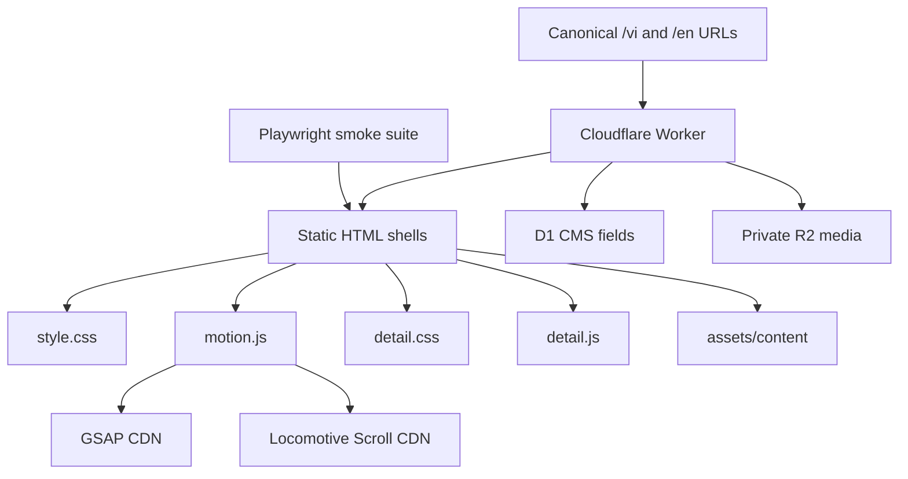

# Kiến trúc

## Tổng quan

Trường Thịnh dùng Cloudflare Worker dependency-free để SSR locale, SEO và CMS
content. HTML/CSS/JS vẫn là static assets; D1 lưu content có schema cố định, R2
lưu media private, và `/admin/` là SPA phía sau Cloudflare Access.



## Route canonical

| Route | Entry file | Page type |
| --- | --- | --- |
| `/vi/`, `/en/` | `src/site/index.html` | Homepage |
| `/vi/residential/`, `/en/residential/` | `src/site/residential/index.html` | Detail |
| `/vi/commercial/`, `/en/commercial/` | `src/site/commercial/index.html` | Detail + horizontal gallery |
| `/vi/advertising-products/`, `/en/advertising-products/` | `src/site/advertising-products/index.html` | Projects và filters |
| `/vi/about/`, `/en/about/` | `src/site/about/index.html` | About/detail |
| `/vi/projects/:slug/`, `/en/projects/:slug/` | advertising-products shell | D1-backed project detail |

`/`, source shell paths, và bốn route cũ `/nha-o/`, `/kinh-doanh/`,
`/quang-cao/`, `/gioi-thieu/` trả một hop `308` sang Vietnamese canonical route,
giữ query. Không có bare public `/residential/` hoặc `/commercial/`.

## Lớp trình bày dùng chung

### `style.css`

- Design tokens, typography, paper/ink palette và breakpoints.
- Header collapse/hide states, full menu, route veil below the persistent header,
  floating Zalo CTA.
- Homepage sections, portals, marquee và footer.
- Responsive chung tại desktop/tablet/mobile.

### `detail.css`

- Detail hero, statement, intro và 16:9 media.
- Detail headings retain the compact layout; section-specific content owns its
  spacing without a shared chapter-divider treatment.
- Horizontal gallery, process grid, asymmetric duo và detail CTA.
- Project filters/grid cho route quảng cáo.

HTML giữ class contract; không đưa layout tuỳ route vào inline style.

## Runtime dùng chung

### `motion.js`

- Nhận locale SSR qua `html[data-route-locale]`; control locale điều hướng sang
  URL counterpart, giữ query/vị trí đọc và loại fragment. Hai control
  `[data-language-option]` chỉ
  nằm trong `#site-menu`; persistent header không render locale toggle trùng.
  `localStorage` chỉ là fallback cho shell ngoài Worker.
- Route veil cho internal route changes và dọn state khi Back/Forward dùng
  BFCache.
- Khi route đổi, `is-hidden` được xoá trước khi phủ veil; header vẫn hiển thị
  phía trên lớp fade và chỉ tắt transition màu để tránh chớp UI.
- Header tone, collapse, hide/show và force-show.
- Full-menu dialog, focus return và bốn direct top-level routes; menu không có
  project CMS, mục con hoặc section hash.
  Public projects trả `{ categories, items }` với category `kind=project`; public
  products lọc `kind=product`. Admin tách resource `project-categories` và
  `product-categories`, validate kind ở write boundary và chặn xoá category đang
  được project/product tham chiếu.
- Canvas TextMetrics đo ink theo font đã render và đặt
  `--mask-ink-overflow`; CSS chỉ mở clip phía trên để dấu tiếng Việt không bị
  cắt mà vẫn giữ reveal mask.
- Locomotive Scroll ở desktop; native scrolling ở mobile.
- Hero carousel, pause/resume và reduced-motion behavior.
- Homepage reveals/marquee/project reel.

Timing, easing và selector mapping được ghi tại
[motion-map.md](../impeccable/motion-map.md). Production chỉ tái tạo hành vi đã đo; bundle
reference lưu trong `research/reference-site/` không được nạp vào website.

### `detail.js`

- Reveal line/media cho child pages.
- Chia line/word theo layout render thật sau `document.fonts.ready`; rebuild khi
  resize hoặc `languagechange`. Hero motto dùng cùng line-reveal contract.
- Điều khiển và pointer drag cho horizontal gallery.
- Filter/reflow project tiles bằng `data-project-filter` và
  `data-project-category`.

`detail.js` là additive: route không có gallery/filter vẫn chạy an toàn.

## HTML contract

Các route lặp lại header/menu/footer markup để giữ static hosting đơn giản, nhưng
phải dùng cùng class và data attributes:

- `[data-site-header]`, `[data-header-tone]`
- `[data-menu-open]`, `[data-menu-close]`
- `#site-menu [data-language-option="vi"]`,
  `#site-menu [data-language-option="en"]`
- `[data-scroll-container]`
- `.route-veil`
- `.floating-cta`

Header và full-menu source dùng ba URL `/vi/residential/`, `/vi/commercial/`,
`/vi/advertising-products/`; Worker rewrite chúng sang locale hiện tại. Không đổi chúng thành section hash: direct route contract giúp
Back/Forward không phải đi qua history entry trung gian.

Detail hooks:

- `[data-detail-lines]`, `[data-detail-reveal]`
- `[data-motion-lines]`, `[data-motion-line-source]`
- `[data-motion-words]`, `[data-motion-word-source]`
- `[data-motion-hero-motto]`
- `[data-gallery]`, `[data-gallery-track]`, `[data-gallery-prev]`,
  `[data-gallery-next]`
- `[data-project-grid]`, `[data-project-filter]`,
  `[data-project-category]`

## Hệ thống VI/EN

Tiếng Việt là source content. Khi tải trang:

1. Worker đặt `html[lang]`, text leaf, title/meta, canonical, hreflang,
   OpenGraph, Twitter và JSON-LD trước response.
2. `data-en*` của shell là fallback cấu trúc; Worker áp field D1 CMS/SEO sau
   fallback để canonical SSR luôn thắng. `motion.js` không dịch lại node tĩnh
   khi `html[data-route-locale]` đã xác nhận response SSR.
3. `motion.js` giữ motion hooks sau khi SSR. Locale EN shell ngoài Worker thay:
   - text bằng `data-en`;
   - `alt` bằng `data-en-alt`;
   - `aria-label` bằng `data-en-aria-label`;
   - meta `content` bằng `data-en-content`.
4. Hai link locale trong full-menu chuyển `/vi/...` ↔ `/en/...`, không chỉ đổi
  local state; header không sở hữu locale control.
5. Event `languagechange` đồng bộ label động và locale href của menu project
   links như motion toggle.

Đặt `data-en` trên node lá; nếu đặt trên parent có markup, việc gán
`textContent` sẽ xoá các span/em bên trong.

Trước khi đổi copy, motto, card/gallery hoặc media, đọc
[CONTENT-MEDIA-GUIDE.md](../product/CONTENT-MEDIA-GUIDE.md). Thứ tự bảo trì nội dung hiện
tại là `/vi/advertising-products/` → `/vi/commercial/` → `/vi/residential/`.

## Invariant của quy trình

Mọi route và test cùng dùng:

```text
Khảo sát → Tư vấn → Sản xuất → Lắp đặt
Survey → Consultation → Production → Installation
```

Đây là invariant nội dung, không chỉ là thứ tự trình bày.

## Kiến trúc asset

```text
assets/content/
├─ client-logos/             # SVG web-ready
├─ projects/                 # project/gallery WebP
├─ news/                     # future news media
└─ shared/                   # process/about/portal WebP

source-assets/
└─ projects/                 # editable originals, excluded from public build

assets/fonts/
├─ instrument-sans-normal-latin.woff2
├─ instrument-sans-normal-latin-ext.woff2
├─ instrument-sans-italic-latin.woff2
└─ instrument-sans-italic-latin-ext.woff2
```

- WebP là asset phục vụ runtime.
- PNG nguồn chỉ giữ khi cần biên tập lại và nằm ngoài public build tree.
- HTML khai báo `width`/`height` để giảm layout shift.
- Hero đầu dùng `src` + `fetchpriority="high"`; slide sau có thể dùng
  `data-src` và được `motion.js` hydrate.
- Ảnh nội dung lazy-load phải được suite cuộn tới trước khi kết luận lỗi.
- Không khuôn mặt nhận diện, trừ `legacy-team.webp` được duyệt.

## Kiến trúc test

`tests/site/site.e2e.cjs` chạy Chromium thật qua Playwright; `tests/worker/worker-contract.cjs`
kiểm tra raw Worker contract:

- Smoke matrix: 5 route × 5 viewport.
- Stepped scroll để kích hoạt lazy image/reveal.
- Console, network, failed images và horizontal overflow.
- Thứ tự process root.
- Portal label alignment.
- Locale persistence.
- Menu open/close/route click và focus return tại 390/1440.
- Direct route, Back/Forward và BFCache cleanup.
- Advertising filters.
- Commercial gallery.
- Home masks và project hover giữ copy.
- Reduced-motion.
- 10 raw `/vi`/`/en` heads, redirect 308/query, robots/sitemap, admin auth,
  CSRF rejection và invalid upload rejection.

Kết quả ghi vào `tests/site/reports/latest.json`; failure screenshots ở
`tests/site/reports/failures/`.

## Reference research archive

`scripts/reference/archive-reference.mjs` crawl tuần tự sitemap public của reference và
first-party media API vào `research/reference-site/archive/`. Manifest
JSONL ghi URL, đường dẫn local, status, MIME, byte, SHA-256 và thời gian fetch.
Thư mục này bị loại khỏi Graphify và không phải runtime dependency.

## Bảo trì Graphify

Graphify Git hook/watcher và query wrapper sở hữu structural freshness; agent
chỉ query wrapper trước câu hỏi kiến trúc/quan hệ file, rồi dùng Serena hoặc
`rg` có scope cho chi tiết. Không tự refresh sau edit. Setup/repair nằm ở
[`docs/operations/graphify.md`](../operations/graphify.md).

Wrapper coalesce AST update khi fingerprint đổi và cảnh báo semantic lag riêng.
Docs/images chưa semantic extraction thì report `semantic update required`; chỉ
build semantic khi user explicit request.

## Dependency bên ngoài

- Plus Jakarta Sans hiện được tải từ Google Fonts, với Arial làm fallback.
- GSAP 3.13 từ jsDelivr.
- Locomotive Scroll 4.1.4 từ jsDelivr.
- Playwright cho local browser tests.

Nếu CDN thất bại, trang vẫn phải giữ nội dung đọc được; motion nâng cao có thể
không chạy.

## Chú thích thuật ngữ

- **SSR**: server-side rendering, render HTML ở Worker trước khi response.
- **Runtime**: phần code chạy khi website đang hoạt động.
- **Contract**: quy ước về markup, data attribute hoặc behavior phải được giữ.
- **Hydrate**: gắn behavior/runtime vào markup đã được render sẵn.
- **Invariant**: điều kiện phải giữ nguyên qua mọi route và test.
- **BFCache**: cơ chế browser cache lại document để Back/Forward nhanh hơn.
- **Structural freshness**: graph cấu trúc còn khớp source hiện tại.
